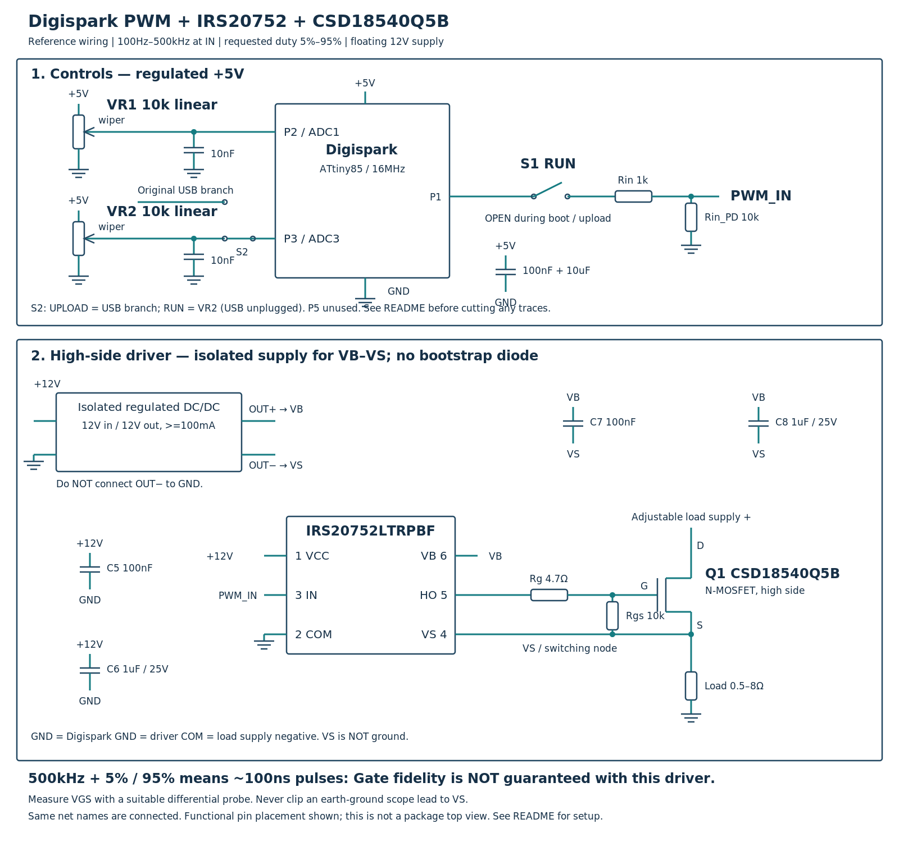

# ATTINY85-Based-PWM-Generator

Digispark 高側 PWM 產生器：P2 調頻率、P3 調佔空比，保留 USB 燒錄切換。



[下載接線圖 PDF](wiring.pdf) · [Arduino 程式](DigisparkPWM/DigisparkPWM.ino)


## 交付範圍

- ATtiny85 / Digispark 硬體 Timer1 輸出，P1 = OC1A。
- 頻率要求範圍：100Hz～500kHz；佔空比要求範圍：5%～95%。
- 兩顆 10kΩ 線性可變電阻，P2 調頻率、P3 調佔空比，附 ADC 濾波與調整遲滯。
- 不需要 ADS1115；P5 不使用，不修改熔絲。
- IRS20752LTRPBF + CSD18540Q5B，高側接法。
- **圖採用獨立浮動 12V 供電，不依靠自舉充電。**
- 不包含功率限制或負載電流控制；負載電源由使用者調整。

## 必須先理解的驅動限制

500kHz 是 MCU 的邏輯輸出能力，不是對實際 Gate 波形的保證。
500kHz 的週期為 2µs；5% 開啟或 95% 關閉時間只有 100ns。
IRS20752 資料表的典型輸出 source/sink 電流為 160mA / 240mA，
典型開啟/關閉傳播延遲為 140ns / 215ns，上升/下降時間為 85ns / 40ns
（資料表指定條件，並非保證最小脈寬）。CSD18540Q5B 在 10V 下的
總 Gate 電荷典型 41nC；不能由此組合保證 500kHz 全範圍 5%～95% 的
實際 MOSFET 導通佔空比。軟體沒有暗中限制這個設定區間。

浮動供電只解決自舉刷新問題，**不會提高驅動電流或消除窄脈波限制**。
若量測不符合需求，需要降低頻率、縮小佔空比範圍，或更換驅動器。

## Arduino IDE 設定與燒錄

1. 安裝 Digistump AVR Boards，選擇 **Digispark (16MHz - No USB)**
   或該核心相對應的 **16MHz、無 USB** 設定。
2. 開啟 `DigisparkPWM/DigisparkPWM.ino`，同資料夾的 `PwmSettings.h`
   必須一起保留。編譯時 `F_CPU` 必須為 16000000；程式會拒絕 16.5MHz 設定。
3. 保留原 Digispark 的 PLL CPU 時脈熔絲。**本交付不修改熔絲或 bootloader**。
4. S1 RUN 開關保持斷開；S2 切到 UPLOAD，PB3 接回原 USB 支路，旋鈕斷開。
   依 Digispark 正常方式由 USB 燒錄。
5. 拔除 USB，將 S2 切到 RUN，PB3 改接 VR2 並與全部 USB 支路隔離。
   使用穩定 5V 供電。等待 bootloader 結束、程式啟動並確認輸出後，再閉合 S1 RUN。
   重新燒錄前斷開 S1，斷電後將 S2 切回 UPLOAD。

這裡的 No USB 指應用程式不使用 USB 通訊；原有 USB bootloader 仍可燒錄。
程式會接管 Timer0 / Timer1 並關閉中斷，不能混用 DigiUSB、Servo、
analogWrite、millis、delay 或依賴中斷的其他函式庫。

時脈採標稱 PLL 64MHz。內部 RC 誤差與核心校正會改變實際頻率；選擇
16MHz 不等於量測校正。若需校正，先量測 PWM，再將 `PWM_CLOCK_HZ`
調成推算的實際 PLL 時脈。要求嚴格不超過 500kHz 時，必須校正並保留裕量。

## 控制端接線：P3 切換版本

| 元件 | 接線 |
|---|---|
| VR1，10kΩ 線性 | 兩端 +5V / GND，中點 P2 / PB2 / ADC1 |
| VR2，10kΩ 線性 | 兩端 +5V / GND，中點接 S2 的 RUN 端 |
| S2，SPDT 或三針跳線 | 共用端接 IC 的 PB3（ATtiny85 實體第 2 腳）；UPLOAD 端接原 USB 支路；RUN 端接 VR2 中點 |
| C1 | 10nF，VR1 中點接 GND |
| C2 | 10nF，VR2 中點接 GND，位於 S2 的旋鈕側，不能留在 USB/PB3 共用側 |
| C3、C4 | 100nF + 10µF，跨接 Digispark +5V / GND |
| PWM | P1 → S1 RUN 開關 → 1kΩ → IRS20752 pin 3 IN |
| IN 下拉 | IRS20752 pin 3 IN → 10kΩ → COM / GND |
| P5 | 留空，不使用 |

### S2 的實體改線

這是需要修改板上走線的版本，**不是只把外部旋鈕由 P5 插到 P3**。
單純拔掉 USB 不會移除板上的箝位及上拉元件。

```
                              ┌─ UPLOAD：全部原 USB 支路
IC PB3（實體 2 腳）─ S2 共用端 ┤          （含相關串聯、箝位、上拉電路）
                              └─ RUN：VR2 中點 + C2
```

1. 先確認自己板子的走線。原版及相容板佈局可能不同，本圖沒有指定割線位置。
2. 在 **IC PB3 與全部 USB 支路的分岔之前**隔開，將兩側分別引到 S2 共用端和
   UPLOAD 端。必要時需移除或移接留在 IC 側的箝位、上拉支路。
3. VR2 中點及其 10nF 電容只接 RUN 端；不接到原 USB 支路。
4. S2 使用先斷後接型 SPDT，或三針跳線且只插一個跳帽；斷電切換。
5. 板子的 P3 排針在割線後可能位於 USB 側，也可能位於 IC 側，必須用導通檔確認，
   不可直接假設 P3 排針就是 S2 共用端。
6. 斷電檢查：RUN 時 IC PB3 應連到旋鈕，並與 USB 支路隔離；UPLOAD 時應連回
   原 USB 支路，並與旋鈕/電容隔離。箝位元件需用電阻/二極體檔進一步檢查，
   單一蜂鳴導通結果不足以證明完全隔離。

這樣在 UPLOAD 位置保留 USB bootloader 的原有連接，RUN 位置才讀取 ADC3。
P4 保留原 USB 電路，不作其他用途。功率控制時 USB 必須拔除。

P5 留空不會自動恢復已停用的 RESET：若板子原本的 RSTDISBL 熔絲已設定，
USB 燒錄仍可使用，但一般 ISP 仍需恢復 RESET 才能工作；本程式不修改熔絲。

原版 P1 連著 LED，本圖以移除 P1 LED 支路串聯電阻為前提。
S1 RUN 是手動隔離 bootloader 輸出的措施，不是軟體自動啟動保護。

## 驅動端接線（腳號依 IRS20752 原廠資料表）

| 腳號 | 名稱 | 連接 |
|---|---|---|
| 1 | VCC | 穩定 +12V，參考 COM；推薦操作範圍 10～18V |
| 2 | COM | 控制地 GND，與 Digispark、負載電源負極共地 |
| 3 | IN | 來自 RUN / 1kΩ，並有 10kΩ 接 COM |
| 4 | VS | MOSFET Source、負載上端、隔離電源 OUT− |
| 5 | HO | 經 Rg = 4.7Ω 接 MOSFET Gate |
| 6 | VB | 隔離電源 OUT+，相對 VS 約 +12V |

- C5 = 100nF、C6 = 1µF / 25V X7R，跨 VCC–COM，貼近 IC。
- C7 = 100nF、C8 = 1µF / 25V X7R，跨 VB–VS，貼近 IC。
- Rgs = 10kΩ，直接跨 MOSFET Gate–Source。
- MOSFET Drain 接可調負載電源正極，Source 接功率電阻，功率電阻另一端接 GND。
- 浮動 12V 建議用**穩壓、隔離式 DC/DC，輸出至少 100mA**；輸出與輸入確實隔離，
  具適合切換節點的隔離額定值與低耦合電容。依模組要求加輸入/輸出電容及最小負載。
  固定 +12V 可供它的輸入，OUT− 必須接 VS，**不得接 COM/GND**。
- 本圖不安裝自舉二極體，不能把 VB 直接接地參考的 +12V。
- +5V、+12V 應使用獨立穩壓電源，或能涵蓋整個輸入調壓範圍的升降壓電源。
  不能預設一般降壓器在負載電源降到 3V 時仍能供應 5V / 12V。
- 可調負載電源不能直接接 Digispark 5V 腳或 IRS20752 VCC。

接線圖是電氣連接圖，方框內腳位按照功能排列，**不是封裝的俯視排列**。
MOSFET 請依 TI 資料表的封裝視圖確認焊盤。驅動器、Rg、MOSFET 的 G/S
回路要短，VS 感測直接取自 Source，避免大電流回路的共用電感。

## 旋鈕與計時器行為

VR1 分三段調整，保留低頻可用的旋鈕行程：大約前 1/3 為 100Hz～1kHz，
中間 1/3 為 1～10kHz，最後 1/3 為 10～500kHz；各段內是線性映射。
VR2 要求值線性映射到 5%～95%。實際頻率及佔空比均為離散階梯。

頻率 = PLL / [預除頻 × (OCR1C + 1)]。
程式週期向上取整，標稱頻率不超過要求值。500kHz 時 TOP=127、預除頻=1，
每步約 0.78125%，兩端向內量化，標稱可用端點約 5.47% 與 94.53%。
不能要求每個頻率都剛好產生精確的 5.000% / 95.000%。

只調佔空比時使用硬體緩衝；頻率參數改變時重啟 Timer1，過渡週期可能縮短。
ADC 濾波和遲滯可減少旋鈕雜訊，但不保證調整期間無過渡脈波。

## 首次量測

1. RUN 開路，先確認 +5V、VCC–COM 的 +12V、VB–VS 的浮動 +12V。
2. 先在 P1 量測頻率與佔空比；確認程式已啟動，再閉合 RUN。
3. 從低頻開始，分別量測 IN–COM、HO–VS、MOSFET G–S。
4. 逐步提高到 500kHz，特別檢查兩端的短開啟、短關閉脈波是否仍存在，
   並檢查高電位幅度、過衝及實際佔空比偏差。
5. **高側 Gate 必須量測 G–S；使用合適的差動探棒。不要把接地式示波器的
   地夾接到 Source/VS，否則會把切換節點接地。**

## 原廠資料

- IRS20752： https://www.infineon.com/assets/row/public/documents/24/49/infineon-irs20752l-datasheet-en.pdf
- CSD18540Q5B： https://www.ti.com/lit/ds/symlink/csd18540q5b.pdf
- ATtiny85： https://ww1.microchip.com/downloads/en/DeviceDoc/Atmel-2586-AVR-8-bit-Microcontroller-ATtiny25-ATtiny45-ATtiny85_Datasheet.pdf

本交付為待實板驗證的參考設計；編譯及參數計算檢查不代表 Gate 波形已驗證。

## 重新產生接線圖與執行參數檢查

```sh
python -m pip install -r requirements.txt
python draw_wiring.py
g++ -std=c++11 -O2 -Wall -Wextra -Werror verify_settings.cpp -o /tmp/verify_pwm
/tmp/verify_pwm
```

AVR 編譯記錄見 `VALIDATION.txt`；參數檢查不代表驅動器與 Gate 波形已通過實測。
